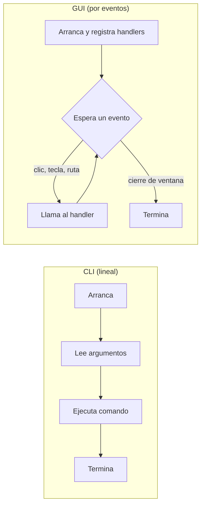
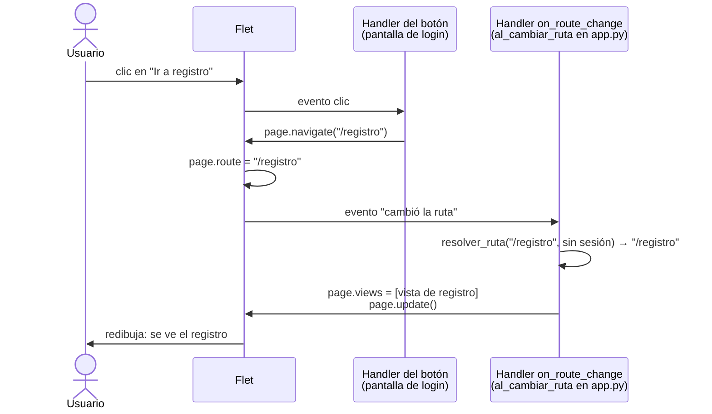
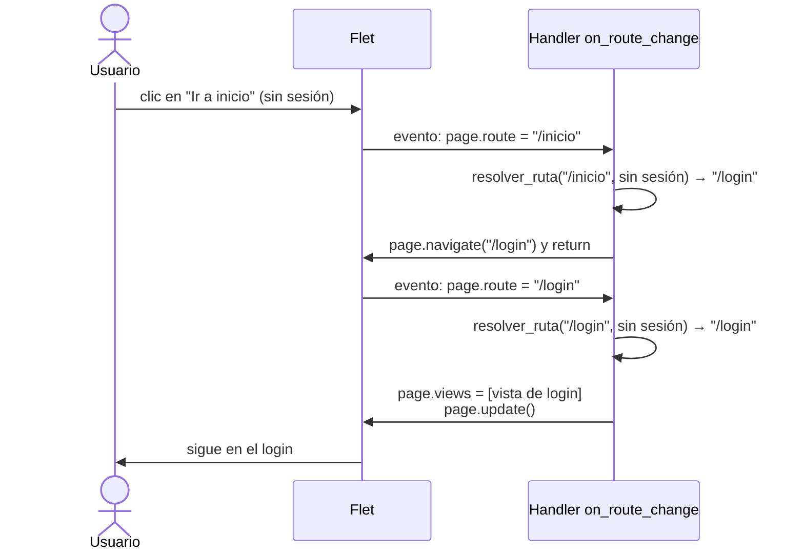
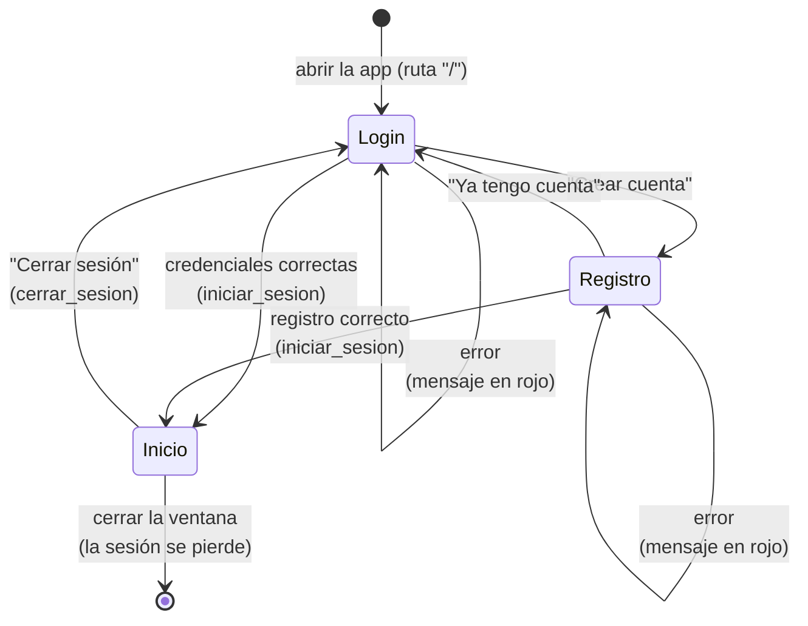
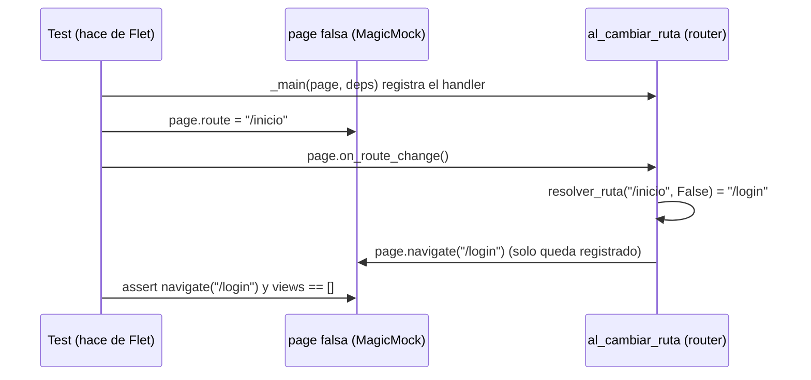

# GUI con Flet — programación por eventos, pantallas y rutas

> Guía de referencia para trabajar en la interfaz gráfica (US-105 en adelante). Está pensada
> para alguien que nunca hizo frontend: arranca por los conceptos y termina en el código real de
> `src/infraestructura/ui/flet/`. Todo lo que dice de Flet se verificó contra la versión fijada en
> `pyproject.toml` (1.1.2).

## Índice

- [GUI con Flet — programación por eventos, pantallas y rutas](#gui-con-flet--programación-por-eventos-pantallas-y-rutas)
  - [Índice](#índice)
  - [1. Qué es Flet](#1-qué-es-flet)
  - [2. Programa lineal vs. programa por eventos](#2-programa-lineal-vs-programa-por-eventos)
  - [3. Handlers: los manejadores de eventos](#3-handlers-los-manejadores-de-eventos)
  - [4. Pantallas: `ft.View` y `page.views`](#4-pantallas-ftview-y-pageviews)
  - [5. Rutas: `page.route` y `page.navigate`](#5-rutas-pageroute-y-pagenavigate)
  - [6. `on_route_change`: el handler que une todo](#6-on_route_change-el-handler-que-une-todo)
    - [La ruta protegida](#la-ruta-protegida)
  - [7. Cómo está armado en el proyecto](#7-cómo-está-armado-en-el-proyecto)
    - [Composition root](#composition-root)
    - [`Dependencias`: lo que usan las pantallas](#dependencias-lo-que-usan-las-pantallas)
    - [Tabla de rutas y router](#tabla-de-rutas-y-router)
    - [`resolver_ruta`: la ruta protegida como función pura](#resolver_ruta-la-ruta-protegida-como-función-pura)
  - [8. Hilos y la conexión a SQLite](#8-hilos-y-la-conexión-a-sqlite)
  - [9. Errores en los handlers](#9-errores-en-los-handlers)
    - [Qué pasa si un handler lanza una excepción](#qué-pasa-si-un-handler-lanza-una-excepción)
    - [Error esperado o bug](#error-esperado-o-bug)
    - [El manejador común: `errores.py`](#el-manejador-común-errorespy)
  - [10. Formularios](#10-formularios)
    - [Los controles](#los-controles)
    - [Leer los valores al hacer clic](#leer-los-valores-al-hacer-clic)
    - [Un mismo handler en dos eventos](#un-mismo-handler-en-dos-eventos)
    - [La pantalla no valida](#la-pantalla-no-valida)
    - [La pantalla de registro completa](#la-pantalla-de-registro-completa)
  - [11. Login, inicio y cerrar sesión](#11-login-inicio-y-cerrar-sesión)
    - [El recorrido completo](#el-recorrido-completo)
    - [Login: un solo mensaje para los dos errores](#login-un-solo-mensaje-para-los-dos-errores)
    - [Inicio: la barra superior (`ft.AppBar`)](#inicio-la-barra-superior-ftappbar)
    - [Cerrar sesión](#cerrar-sesión)
  - [12. Cómo se testea](#12-cómo-se-testea)
    - [Testear una pantalla sin abrir la ventana](#testear-una-pantalla-sin-abrir-la-ventana)
    - [Testear el router con una `page` falsa](#testear-el-router-con-una-page-falsa)
    - [Ningún test abre la ventana](#ningún-test-abre-la-ventana)
    - [El smoke test del CI: `import main`](#el-smoke-test-del-ci-import-main)
  - [13. Errores comunes](#13-errores-comunes)
  - [14. Checklist: agregar una pantalla nueva](#14-checklist-agregar-una-pantalla-nueva)

---

## 1. Qué es Flet

**Flet** es una librería para hacer interfaces gráficas en Python. Por debajo usa **Flutter**, el
framework de Google para apps, pero no hace falta saber Flutter ni Dart: todo se escribe en Python.

Por dentro funciona como cliente y servidor en la misma máquina:

- **Tu código Python** es el "servidor": dice qué hay que mostrar.
- **La ventana** (hecha con Flutter, el paquete `flet-desktop`) es el "cliente": dibuja y avisa
  lo que hace el usuario.
- Se comunican por un socket local.

Por eso existe `page.update()`: cuando cambiás algo de la pantalla, tenés que avisarle al cliente
que lo redibuje.

**Vocabulario básico:**

| Término   | Qué es                                                                           |
| --------- | -------------------------------------------------------------------------------- |
| `ft.Page` | La ventana. Flet te la entrega al arrancar                                       |
| Control   | Cualquier elemento visible: `ft.Text`, `ft.TextField`, `ft.Button`, `ft.Column`… |
| `ft.View` | Una pantalla completa (login, inicio…) con sus controles adentro                 |
| Evento    | Algo que pasó: un clic, una tecla, un cambio de ruta, el cierre de la ventana    |
| Handler   | Una función tuya que Flet llama cuando ocurre un evento                          |
| Ruta      | El nombre de una pantalla, como `"/login"` o `"/inicio"`                         |

**El punto de entrada** es `ft.run(main)`. Arranca la ventana, llama una vez a `main(page)` y se
queda esperando eventos hasta que se cierra la ventana. En Flet 1.x **ya no existe
`ft.app(target=main)`**, que es lo que muestran casi todos los tutoriales viejos (serie 0.x).

---

## 2. Programa lineal vs. programa por eventos

**La CLI que tenía el proyecto era lineal.** Arrancaba, leía los argumentos, ejecutaba el comando y
terminaba. El orden lo decidía el programa:

```text
main() → parse_args() → auth_login.ejecutar() → print(...) → fin
```

**Una GUI no puede funcionar así**, porque no sabe qué va a hacer el usuario ni cuándo: puede
escribir, hacer clic, cerrar la ventana o no hacer nada durante diez minutos. Entonces el programa se
invierte:

1. Al arrancar, se arma la ventana y **se deja anotado qué hacer si pasa cada cosa**.
2. El programa **se queda esperando**. Eso es lo que hace `ft.run(...)`.
3. Cuando el usuario hace algo, Flet busca lo que se anotó para ese caso y lo ejecuta.

Esto se llama **programación orientada a eventos**: el flujo no lo decide el programa, lo deciden los
eventos que llegan.



---

## 3. Handlers: los manejadores de eventos

Un **handler** (manejador de eventos) es **una función tuya que Flet llama cuando ocurre un evento**.
Se llama así porque "maneja" ese evento: es la respuesta a "¿qué hago si pasa esto?".

Vos no la llamás: se la **entregás** a Flet y Flet la llama cuando corresponde. Todos los atributos
`on_algo` de Flet (`on_click`, `on_change`, `on_route_change`…) son lugares para enchufar un handler.

```python
def al_hacer_clic() -> None:
    print("hicieron clic")

ft.Button("Ingresar", on_click=al_hacer_clic)   # sin paréntesis: se entrega la función, no se ejecuta
```

`on_click=al_hacer_clic` se lee "cuando hagan clic, llamá a esto".

**Ya lo conocés de otros lados:**

- **Interrupciones de un microcontrolador.** Es la misma idea que una rutina de servicio de
  interrupción (ISR): el programa principal hace su vida y, cuando llega la interrupción, el hardware
  salta a la rutina que registraste. Evento = interrupción, handler = ISR.
- **La CLI retirada.** `set_defaults(func=auth_login.ejecutar)` registraba un handler: "si el comando
  es `auth login`, lo atiende esta función". No la llamaba en ese momento, la dejaba anotada.

**Con o sin parámetro.** Flet cuenta los parámetros del handler: si no tiene ninguno, lo llama sin
argumentos; si tiene uno, le pasa el evento (`e`), con datos como qué control lo disparó. En el
proyecto se usan handlers sin parámetros cuando el evento no aporta nada.

---

## 4. Pantallas: `ft.View` y `page.views`

- **`ft.View`** es **una pantalla completa**: el login es una `View`, el inicio es otra. Adentro tiene
  sus controles.
- **`page.views`** es **una lista de `View`**, y la ventana **muestra la última**. Es como un mazo de
  cartas boca arriba: se ve la de arriba.

Para cambiar lo que se ve, se cambia esa lista y se pide redibujar:

```python
page.views.clear()                  # saco todas las cartas
page.views.append(vista_de_login)   # pongo la del login
page.update()                       # sin esto, la ventana no cambia
```

En la US-105 la lista tiene siempre **una sola** `View`. Tener varias apiladas sirve para navegación
jerárquica con botón "atrás" (por ejemplo club → jugadores → detalle), que se maneja con el evento
`page.on_view_pop`. Todavía no se usa.

---

## 5. Rutas: `page.route` y `page.navigate`

- **Una ruta** es **un nombre para cada pantalla**: `"/login"`, `"/registro"`, `"/inicio"`. Es la
  misma idea que la URL de una web (`/inbox`, `/settings`). La barra inicial es convención.
- **`page.route`** es **un string con la pantalla actual**, como un cartel de "usted está aquí".
  Al arrancar vale `"/"`.
- **`page.navigate("/inicio")`** **pide** cambiar la ruta. **No dibuja nada**: cambia el cartel y
  dispara el evento "cambió la ruta". Es la versión síncrona de `page.push_route(...)`, que es
  `async`; por eso es la que se usa dentro de un `on_click` común. En Flet 1.x `page.go()` ya no
  existe.

**¿Por qué no cambiar `page.views` directo desde cada botón?** Funciona, pero:

- cada botón tendría que saber construir la pantalla de destino, así que cada pantalla conocería a
  todas las demás;
- la ruta protegida (no entrar sin sesión) habría que copiarla en cada botón;
- `page.route` dejaría de coincidir con lo que se ve.

Con rutas, **el botón solo dice adónde quiere ir** y **un único lugar decide** qué pantalla
corresponde y si se puede entrar.

---

## 6. `on_route_change`: el handler que une todo

`page.on_route_change` es el evento **"cambió la ruta"**. Su handler es la función que mira
`page.route` y arma `page.views` en consecuencia. Es el **router** de la aplicación.

Cada clic que cambia de pantalla pasa por **dos handlers en cadena**:

1. el del botón, que solo pide ir a otra ruta;
2. el de `on_route_change`, que decide y dibuja.



### La ruta protegida

Como todo cambio de pantalla pasa por el handler de `on_route_change`, la ruta protegida vive ahí y
**no hay forma de saltearla**. Si se pide una pantalla a la que no se puede entrar, el handler
**cambia la ruta** (no solo la pantalla) y Flet lo vuelve a llamar con la ruta corregida:



**Regla: la pantalla que se ve siempre coincide con `page.route`.** Si el handler dibujara el login
sin cambiar la ruta, `page.route` quedaría en `"/inicio"`. Cuando el usuario iniciara sesión y se
llamara a `page.navigate("/inicio")`, la ruta no cambiaría, Flet no dispararía el evento y la
pantalla se quedaría en el login.

---

## 7. Cómo está armado en el proyecto

```text
src/
├── main.py                    ← punto de entrada: solo llama a ejecutar()
└── infraestructura/ui/flet/
    ├── app.py                 ← composition root + rutas + ruta protegida + router
    ├── errores.py             ← manejador común de errores de los handlers (sección 9)
    └── screens/
        ├── login_screen.py       crear_login_view(page, login_uc, sesion) -> ft.View
        ├── registro_screen.py    crear_registro_view(page, registrar_uc, sesion) -> ft.View
        └── inicio_screen.py      crear_inicio_view(page, sesion) -> ft.View
```

Se abre con `uv run python src/main.py`. `main.py` no arma nada: importa `ejecutar` de `app.py` y lo
llama. Así el punto de entrada no cambia aunque cambie la interfaz (antes ahí vivía todo el parser de
la CLI) y el armado queda en un solo lugar.

### Composition root

El **composition root** es el único lugar donde se eligen las clases concretas (SQLite, PBKDF2) y
se conectan entre sí. En el proyecto es `ejecutar()` de `app.py`:

1. abre la conexión e inicializa el esquema;
2. `construir_dependencias(conexion, hasher)` arma el repositorio, la sesión y los casos de uso;
3. corre `ft.run(lambda page: _main(page, deps))`;
4. en el `finally` cierra la conexión, aunque algo falle.

La lambda del paso 3 existe porque `ft.run` necesita una función que reciba **solo** `page`, y
`_main` necesita además `deps`. La lambda "recuerda" `deps` (es una _closure_) y entrega una función
de un solo parámetro.

### `Dependencias`: lo que usan las pantallas

```python
@dataclass
class Dependencias:
    sesion: SessionManager
    registrar_uc: RegistrarEntrenadorUseCase
    login_uc: LoginLocalUseCase
```

- Solo tiene **la sesión y casos de uso**. La conexión, los repositorios y el hasher son materiales
  de construcción y quedan como variables locales de `ejecutar()`. Si una pantalla tuviera el
  repositorio, podría guardar datos salteándose las validaciones del caso de uso.
- Crece un campo por cada caso de uso que use alguna pantalla. Eso no es problema porque **solo la
  tabla de rutas recibe `Dependencias` entero**: cada pantalla recibe por parámetro únicamente lo que
  usa. Si en algún momento se vuelve incómodo, se parte por área (`DepsAuth`, `DepsClubes`…).

### Tabla de rutas y router

Dentro de `_main`:

```python
rutas: dict[str, Callable[[], ft.View]] = {
    RUTA_LOGIN: lambda: crear_login_view(page, deps.login_uc, deps.sesion),
    RUTA_REGISTRO: lambda: crear_registro_view(page, deps.registrar_uc, deps.sesion),
    RUTA_INICIO: lambda: crear_inicio_view(page, deps.sesion),
}

def al_cambiar_ruta() -> None:
    destino = resolver_ruta(page.route, deps.sesion.is_authenticated())
    if destino != page.route:
        page.navigate(destino)
        return
    page.views.clear()
    page.views.append(rutas[destino]())
    page.update()

page.on_route_change = al_cambiar_ruta
al_cambiar_ruta()  # dibuja la primera pantalla (al arrancar, page.route es "/")
```

- **Las lambdas** hacen que cada pantalla se construya **recién al navegar** y de nuevo cada vez.
  Así, al volver al login, el formulario aparece vacío.
- **La última línea** llama al handler a mano una vez para dibujar la primera pantalla, como hace el
  ejemplo oficial de Flet.
- **Las pantallas no se conocen entre sí:** navegan por ruta, nunca importando otra pantalla. Es el
  mismo desacople que daba el Command Pattern en la CLI retirada
  ([06-patron-command.md](06-patron-command.md)).

### `resolver_ruta`: la ruta protegida como función pura

```python
def resolver_ruta(ruta: str, autenticado: bool) -> str:
    if autenticado:
        return ruta if ruta in RUTAS_INTERNAS else RUTA_INICIO
    return ruta if ruta in RUTAS_PUBLICAS else RUTA_LOGIN
```

| Sesión | Ruta pedida                                  | Destino   |
| ------ | -------------------------------------------- | --------- |
| No     | `/login`, `/registro`                        | la misma  |
| No     | cualquier otra (`/`, `/inicio`, desconocida) | `/login`  |
| Sí     | `/inicio` (rutas internas)                   | la misma  |
| Sí     | cualquier otra (`/`, `/login`, `/registro`…) | `/inicio` |

Es una **función pura**: no toca la ventana y para las mismas entradas da siempre el mismo
resultado. Por eso se testea sin abrir nada.

---

## 8. Hilos y la conexión a SQLite

`sqlite3` no deja usar una conexión desde un hilo distinto del que la creó (`ProgrammingError: SQLite
objects created in a thread can only be used in that same thread`).

En **Flet 1.x** eso no es un problema con el diseño actual:

- `ft.run` usa `asyncio.run(...)`: el bucle de eventos corre en el **hilo principal**;
- `_main` y los handlers **síncronos** se ejecutan dentro de ese bucle, en el mismo hilo.

Entonces una sola conexión, abierta en `ejecutar()`, sirve para toda la app. En Flet 0.x los handlers
corrían en un pool de hilos, por eso hay material viejo que dice lo contrario.

**Letra chica:**

- Un handler síncrono **bloquea la interfaz** mientras corre. Para una consulta a SQLite son
  milisegundos; para algo largo (importar un Excel, US-201) habrá que pensarlo.
- Si se usa `page.run_thread(...)` o se crean hilos a mano, la conexión vuelve a ser un problema.

---

## 9. Errores en los handlers

### Qué pasa si un handler lanza una excepción

En la CLI, `main()` atrapaba `ErrorDeDominio`, mostraba el mensaje y **terminaba el programa**. En
una GUI eso no sirve: si el email está repetido, el usuario tiene que ver el aviso y corregirlo, con
la app abierta.

Y si nadie atrapa la excepción, es peor: Flet la registra y le manda a la ventana un mensaje
`SESSION_CRASHED` con el **traceback completo**. La sesión queda rota y el usuario ve un error de
Python. Por eso **todo handler que llama a un caso de uso tiene que atrapar las excepciones**.

### Error esperado o bug

| Clase                                       | Ejemplo                                              | Qué ve el usuario         | Qué queda en el log    |
| ------------------------------------------- | ---------------------------------------------------- | ------------------------- | ---------------------- |
| `ErrorDeDominio` (el usuario se equivocó)   | contraseña corta, email repetido                     | El mensaje del error      | Un `warning` corto     |
| Cualquier otra excepción (un bug)           | `TypeError`, `RuntimeError` de `usuario_actual()`    | Un mensaje genérico       | El traceback completo  |

- Todas las excepciones de negocio heredan de `ErrorDeDominio` (`src/dominio/exceptions.py`), así
  que un solo `except ErrorDeDominio` las atrapa a todas, y su mensaje ya está escrito para el
  usuario.
- Atrapar `Exception` en general es mala práctica porque esconde bugs. Acá se justifica porque es
  **el borde de la aplicación**: el último lugar antes de que el error rompa la sesión. El bug no se
  esconde: queda en `logs/app.log` con `logger.exception(...)`.
- Al usuario nunca se le muestra `str(e)` de un bug: puede tener detalles internos (rutas, SQL).

### El manejador común: `errores.py`

Para no repetir el `try/except` en cada pantalla, la acción se **envuelve** (_wrapper_): se le pasa
"lo que hay que hacer" como función a otra función que hace el `try/except`. Es la misma idea de
entregarle un handler a Flet, pero ahora a código propio.

```python
def ejecutar_mostrando_errores(accion: Callable[[], None], etiqueta: ft.Text) -> None:
    etiqueta.value = ""                      # borra el error del intento anterior
    try:
        accion()
    except ErrorDeDominio as e:
        logger.warning(f"Error de dominio en la GUI: {e}")
        etiqueta.value = str(e)
    except Exception:
        logger.exception("Error inesperado en la GUI")
        etiqueta.value = MENSAJE_ERROR_INESPERADO
```

Cómo lo usa una pantalla:

```python
etiqueta_error = crear_etiqueta_error()     # ft.Text con el color de error del tema, debajo del formulario

def al_hacer_clic_registrar() -> None:
    def accion() -> None:
        usuario = registrar_uc.ejecutar(RegistrarDTO(...))
        sesion.iniciar_sesion(usuario)
        page.navigate("/inicio")             # adentro de la acción: si el caso de uso falla, no se navega
    ejecutar_mostrando_errores(accion, etiqueta_error)
    page.update()
```

- **El error se muestra en un `ft.Text` debajo del formulario**, no en el campo que falló
  (`TextField.error_text`): para eso habría que mapear cada excepción a su campo, y
  `DatoInvalidoError` no dice qué campo falló. Tampoco en un `SnackBar` (el aviso flotante que se
  borra solo): sirve para confirmaciones, no para un error que hay que corregir.
- **`ejecutar_mostrando_errores` no llama a `update()`**: lo hace el handler de la pantalla. Un
  control que no está en ninguna ventana da error si se le llama `update()`, y así la función se
  testea con un `ft.Text()` suelto.

---

## 10. Formularios

Un formulario es un grupo de campos que el usuario completa y envía con un botón. El primero del
proyecto es el de registro (`screens/registro_screen.py`).

### Los controles

| Control / parámetro                         | Qué hace                                                                             |
| ------------------------------------------- | ------------------------------------------------------------------------------------ |
| `ft.TextField(label="Email")`               | Un campo de texto. `label` es el título que se ve en el campo                        |
| `campo.value`                               | **Lo que escribió el usuario.** Flet lo actualiza solo mientras se tipea             |
| `password=True`                             | Muestra `•••` en vez del texto                                                       |
| `can_reveal_password=True`                  | Agrega el ícono del ojo para ver la contraseña                                       |
| `autofocus=True`                            | El cursor arranca en ese campo                                                       |
| `keyboard_type=ft.KeyboardType.EMAIL`       | En el celular muestra el teclado con `@` (en escritorio no cambia nada)              |
| `on_submit`                                 | Evento "apretó Enter" en el campo                                                    |
| `ft.Button("...")` / `ft.TextButton("...")` | Botón con fondo / botón que parece un enlace (para acciones secundarias)             |
| `ft.Column([...])`                          | Control de **layout** (disposición): apila otros controles en vertical               |

Un `View` ya apila sus controles en vertical, así que `ft.Column` solo hace falta para agrupar (por
ejemplo, darle un ancho máximo a un formulario y centrarlo).

### Leer los valores al hacer clic

Hay dos estilos para saber qué escribió el usuario:

- **Leer en el momento del envío:** el handler del botón hace `nombre.value`, `email.value`… Es el
  que usa el proyecto.
- **Escuchar cada tecla** (`on_change` en cada campo) y guardar una copia aparte. Sirve para validar
  mientras se escribe, y eso no le corresponde a la pantalla.

**`campo.value` leído al construir la pantalla vale `""`**: el usuario todavía no escribió nada. Se
lee adentro del handler.

### Un mismo handler en dos eventos

```python
def registrar() -> None:
    ...

password.on_submit = registrar                      # Enter en la contraseña
ft.Button("Registrarme", on_click=registrar)        # clic en el botón
```

Un handler es una función común: se puede enchufar en todos los eventos que se quiera.

### La pantalla no valida

El formulario de registro **no** comprueba campos vacíos, formato del email ni largo de la
contraseña:

- nombre y email vacíos, y el formato del email, los valida la entidad `Usuario`;
- el largo mínimo de la contraseña y el email repetido, el caso de uso.

Todo llega como `ErrorDeDominio` y `ejecutar_mostrando_errores` lo muestra. Si la pantalla también
validara, la regla quedaría escrita dos veces y tarde o temprano las dos copias dirían cosas
distintas. Es lo que el PRD llama **pantalla fina**.

### La pantalla de registro completa

```python
def crear_registro_view(page, registrar_uc, sesion) -> ft.View:
    nombre = ft.TextField(label="Nombre", autofocus=True)
    email = ft.TextField(label="Email", keyboard_type=ft.KeyboardType.EMAIL)
    password = ft.TextField(label="Contraseña", password=True, can_reveal_password=True)
    error = crear_etiqueta_error()

    def registrar() -> None:
        def accion() -> None:
            usuario = registrar_uc.ejecutar(RegistrarDTO(nombre=nombre.value, email=email.value, password=password.value))
            if usuario is None:
                raise RuntimeError("...")    # el repositorio devuelve None si SQLite falló
            sesion.iniciar_sesion(usuario)
            page.navigate("/inicio")
        ejecutar_mostrando_errores(accion, error)
        page.update()

    password.on_submit = registrar
    return ft.View(route="/registro", controls=[ft.Text("Registrarse", size=24), nombre, email,
                                                password, error,
                                                ft.Button("Registrarme", on_click=registrar),
                                                ft.TextButton("Ya tengo cuenta", on_click=lambda: page.navigate("/login"))])
```

- **`registrar` y `accion` son funciones internas** (definidas dentro de otra función). Pueden usar
  `nombre`, `email`, `page`… porque son _closures_: recuerdan las variables del lugar donde se
  crearon. Por eso la pantalla no necesita ser una clase para guardar sus campos.
- **Al registrarse, el usuario entra directo**: `RegistrarEntrenadorUseCase` devuelve el mismo
  `UsuarioDTO` que el login, así que se inicia la sesión y se navega a `/inicio`.
- **El `if usuario is None`**: el caso de uso declara `UsuarioDTO | None` porque el repositorio
  devuelve `None` si SQLite falla al guardar. No es un error del usuario, así que se trata como bug
  (mensaje genérico y traceback en el log). mypy obliga a manejarlo: sin ese `if`,
  `sesion.iniciar_sesion(usuario)` no compila con `--strict`.
- **Nunca loguear el DTO** (`logger.info(f"{dto}")`): el `repr` de un dataclass incluye todos sus
  campos, contraseña incluida.
- **No se limpian los campos después de un error**: el usuario corrige solo lo que falló.

---

## 11. Login, inicio y cerrar sesión

### El recorrido completo

Con las tres pantallas, la sesión y la ruta protegida, la app completa se comporta así:



Cada flecha es un `page.navigate(...)` dentro de un handler; el router decide qué se dibuja. Las
flechas de error no navegan: se queda la misma pantalla con el mensaje.

### Login: un solo mensaje para los dos errores

`login_screen.py` tiene la misma forma que el registro (sección 10): dos campos, el handler
`ingresar` enchufado al botón y al Enter de la contraseña, y la acción envuelta en
`ejecutar_mostrando_errores`. La diferencia está en el caso de uso: si el email no existe **o** la
contraseña no coincide, `LoginLocalUseCase` lanza el mismo `CredencialesInvalidasError("Email o
contraseña incorrectos")`.

- **Por qué un solo mensaje:** si dijera "ese email no está registrado", cualquiera podría probar
  emails y averiguar quién tiene cuenta. Ese ataque se llama **enumeración de usuarios** (_user
  enumeration_). Con un mensaje único, el atacante no distingue los dos casos.
- La pantalla no sabe nada de esto: muestra `str(e)` como con cualquier `ErrorDeDominio`. La regla de
  seguridad vive en el caso de uso, que es donde se testea.

### Inicio: la barra superior (`ft.AppBar`)

```python
def crear_inicio_view(page, sesion) -> ft.View:
    usuario = sesion.usuario_actual()

    def cerrar_sesion() -> None:
        sesion.cerrar_sesion()
        page.navigate("/login")

    return ft.View(
        route="/inicio",
        appbar=ft.AppBar(
            title=ft.Text("StatsPro"),
            actions=[ft.TextButton("Cerrar sesión", on_click=cerrar_sesion)],
        ),
        controls=[ft.Text(f"Hola, {usuario.nombre}", size=24)],
    )
```

- **`ft.AppBar`** es la barra de arriba de la pantalla. Se le pasa al `View` en `appbar=`, **no** en
  `controls`. `title` va a la izquierda; `actions` es una lista de controles que van a la derecha.
  Es el lugar estándar para acciones de toda la pantalla, como cerrar sesión.
- **`sesion.usuario_actual()` se llama al construir la pantalla**, no en un handler: el nombre no
  cambia mientras la pantalla está abierta. Si no hay sesión lanza `RuntimeError`, pero eso no puede
  pasar porque la ruta protegida nunca construye `/inicio` sin sesión. Si pasara, es un bug y conviene
  que explote.
- **No tiene menú todavía:** no hay secciones a las que ir. El menú llega con las pantallas de
  gestión (US-106 y US-107).

### Cerrar sesión

El handler hace dos cosas, en este orden:

1. `sesion.cerrar_sesion()`: el `SessionManager` vuelve a "nadie".
2. `page.navigate("/login")`: Flet cambia la ruta y llama al router. El router ve que no hay
   sesión y que `/login` es pública, así que lo dibuja. Se construye **de nuevo**, con los campos
   vacíos.

Si el orden fuera al revés, el router recibiría `/login` con la sesión todavía abierta y
`resolver_ruta` lo mandaría de vuelta a `/inicio`. No hace falta borrar `page.views` a mano: el router
siempre reemplaza la pantalla.

---

## 12. Cómo se testea

Flet no trae una herramienta madura para testear la ventana. La estrategia del proyecto es tener
**pantallas finas** (sin lógica de negocio) y testear todo lo que no depende de la ventana:

| Qué                                  | Test                                     | Tipo        |
| ------------------------------------ | ---------------------------------------- | ----------- |
| `SessionManager`                     | `tests/unit/test_session_manager.py`     | Unitario    |
| `resolver_ruta` (ruta protegida)     | `tests/unit/test_navegacion.py`          | Unitario    |
| Manejador de errores (`errores.py`)  | `tests/unit/test_errores.py`             | Unitario    |
| Pantalla de registro (sin ventana)   | `tests/unit/test_registro_screen.py`     | Unitario    |
| Pantalla de login (sin ventana)      | `tests/unit/test_login_screen.py`        | Unitario    |
| Pantalla de inicio (sin ventana)     | `tests/unit/test_inicio_screen.py`       | Unitario    |
| Router (`_main`) con `page` falsa    | `tests/unit/test_navegacion.py`          | Unitario    |
| Cableado de `construir_dependencias` | `tests/integration/test_sesion_flujo.py` | Integración |
| Todos los casos de uso juntos        | `tests/integration/test_flujo_casos_de_uso.py` | Integración |
| Cómo se ven las pantallas            | Prueba manual guiada                     | Manual      |

`test_navegacion.py` incluye un test que comprueba que **el destino es estable**: aplicar
`resolver_ruta` dos veces da lo mismo que una. Si alguien rompe eso, el router entraría en un bucle
de redirecciones infinito.

Importar `app.py` **no abre la ventana ni la base**: todo eso pasa dentro de `ejecutar()`. Por eso
los tests pueden importar `construir_dependencias` y `resolver_ruta` sin efectos secundarios.

Para revisar qué se escribió en el log, pytest trae la fixture **`caplog`**, que captura los
registros de `logging` durante el test (`caplog.records`, `caplog.text`). `test_errores.py` la usa
para comprobar que un bug deja su traceback en el log y que la contraseña nunca aparece.

### Testear una pantalla sin abrir la ventana

Una pantalla se puede testear sin ventana gracias a dos decisiones de diseño:

- **recibe `page` por parámetro**, así que en el test se le pasa un `MagicMock(spec=ft.Page)` y
  después se pregunta si se llamó a `page.navigate("/inicio")`;
- **sus handlers no tienen parámetros**, así que el test puede llamarlos directo, como haría Flet
  al recibir el clic.

Los pasos de un test (`tests/unit/test_registro_screen.py`, igual en login e inicio):

1. Armar la pantalla con mocks: `crear_registro_view(page_mock, registrar_uc_mock, SessionManager())`.
2. Cargar los campos a mano: `campo.value = "profe@test.com"` (es lo que haría el usuario al tipear).
3. "Hacer clic": `boton.on_click()`.
4. Verificar:
   - que se llamó al caso de uso con el DTO correcto (`assert_called_once_with(RegistrarDTO(...))`);
   - que se inició la sesión y se navegó;
   - en los casos de error (`registrar_uc.ejecutar.side_effect = EmailYaRegistradoError(...)`), que
     el mensaje quedó en la etiqueta y que **no** se navegó (`page.navigate.assert_not_called()`).

Para encontrar los controles dentro del `View`, los tests usan `tests/unit/ayudantes_flet.py`, que
los busca **por tipo y por texto**, no por posición, así no se rompen si se reordena el formulario:

```python
def campo(vista: ft.View, label: str) -> ft.TextField:
    return next(c for c in vista.controls if isinstance(c, ft.TextField) and c.label == label)


def boton(vista: ft.View, texto: str) -> ft.Button | ft.TextButton:
    acciones = list(vista.appbar.actions or []) if isinstance(vista.appbar, ft.AppBar) else []
    return next(
        c for c in [*vista.controls, *acciones] if isinstance(c, ft.Button | ft.TextButton) and c.content == texto
    )
```

- **`ft.TextButton` no hereda de `ft.Button`** (en Flet 1.1.2 son clases hermanas). Por eso `boton`
  pregunta por los dos tipos: con `isinstance(c, ft.Button)` solo, "Cerrar sesión" no se encontraría.
- **`boton` también mira las `actions` de la `AppBar`**: el botón de cerrar sesión no está en
  `controls`.
- **El texto de un botón está en `content`**: `ft.Button("Ingresar")` guarda `"Ingresar"` en
  `boton.content`.
- Los tests lo importan con `from ayudantes_flet import campo, boton`: pytest agrega la carpeta del
  test al `sys.path`, así que funciona sin `__init__.py`.

Lo que estos tests **no** cubren es cómo se ve la pantalla (tamaños, colores, que el botón no quede
tapado). Eso sigue siendo prueba manual.

### Testear el router con una `page` falsa

El router (`_main`) no se puede testear llamando a un botón: reacciona a `page.on_route_change`, que
en la app real llama Flet. En el test **el test hace de Flet**: arma una `page` falsa con una ruta y
una lista de pantallas reales, y después cambia `page.route` y llama al handler a mano.

```python
@pytest.fixture
def page():
    page = MagicMock(spec=ft.Page)
    page.route = "/"
    page.views = []          # lista real: así se puede mirar qué pantalla quedó dibujada
    return page


def test_sin_sesion_inicio_redirige_al_login_sin_dibujar(page, deps):
    _main(page, deps)
    page.navigate.reset_mock()     # olvidar la redirección del arranque ("/" -> "/login")
    page.route = "/inicio"

    page.on_route_change()         # "Flet avisa que cambió la ruta"

    page.navigate.assert_called_once_with("/login")
    assert page.views == []
```



`page.navigate` en el mock **no** cambia la ruta ni vuelve a llamar al router (eso lo haría Flet). Por
eso el test controla cada paso a mano y puede revisar el estado en el medio.

### Ningún test abre la ventana

`ft.run(...)` abre la ventana y **se queda esperando hasta que alguien la cierre**. Si un test lo
llamara (por ejemplo, llamando a `main.main()`), la suite quedaría colgada; en el CI nadie cerraría
la ventana y el job moriría por _timeout_. Pasó de verdad: un test viejo de la CLI llamaba a
`main.main()` y, con la GUI, abrió la ventana en medio de la corrida.

La protección está en `tests/conftest.py`:

```python
@pytest.fixture(autouse=True)
def prohibir_abrir_la_ventana(monkeypatch):
    def _falla(*args, **kwargs):
        raise RuntimeError("Un test intento abrir la ventana de Flet (ft.run): testear sin ventana")

    monkeypatch.setattr("flet.run", _falla)
```

- **`autouse=True`** hace que la fixture se aplique a **todos** los tests sin que la pidan.
- **`monkeypatch.setattr("flet.run", ...)`** reemplaza `ft.run` solo durante el test. Funciona
  porque `app.py` llama a `ft.run(...)` buscándolo en el módulo `flet` en el momento de la llamada.
- Un test que intente abrir la ventana falla enseguida con un mensaje claro, en vez de colgarse.

### El smoke test del CI: `import main`

El CI corre `uv run --locked python -c "import main"` antes de los tests. Importar `main` importa
toda la app (pantallas, casos de uso, repositorios): si falta una dependencia o hay un import roto,
falla ahí. **No abre la ventana ni crea la base** porque eso pasa dentro de `ejecutar()`, y
`main.py` solo lo llama bajo `if __name__ == "__main__":`. Antes, con la CLI, el paso era
`python src/main.py --help`; con la GUI, ejecutar `main.py` abriría una ventana.

---

## 13. Errores comunes

- **`on_click=funcion()` con paréntesis.** Ejecuta la función en ese momento y le entrega a Flet lo
  que devuelve (`None`). Va sin paréntesis, o con una lambda: `on_click=lambda: page.navigate("/x")`.
- **Olvidar `page.update()`** después de cambiar `page.views` o un control. No se redibuja nada.
- **Redirigir dibujando otra pantalla sin cambiar la ruta.** Ver la regla de la
  [sección 6](#la-ruta-protegida).
- **Olvidar el `return` después de `page.navigate`** en el router. Se dibuja la pantalla vieja y
  enseguida la nueva.
- **Construir las pantallas una sola vez** (`{"/login": crear_login_view(page, ...)}`, sin lambda). Al
  volver, el formulario conserva lo que se escribió antes.
- **Que una pantalla importe otra pantalla** para navegar. Se navega por ruta.
- **Que una pantalla importe repositorios o `infraestructura.persistencia`.** Las pantallas reciben
  casos de uso; el cableado vive solo en `app.py`.
- **Abrir la conexión a nivel de módulo** (fuera de una función). Se abriría con solo importar
  `app.py`, incluido en los tests y en el smoke test del CI.
- **Copiar ejemplos de Flet 0.x** (`ft.app(target=...)`, `page.go(...)`). En 1.x no existen.
- **Llamar a un caso de uso desde un handler sin `ejecutar_mostrando_errores`.** El primer error
  del usuario rompe la sesión. Ver la [sección 9](#9-errores-en-los-handlers).
- **`except Exception` sin `logger.exception`.** El bug desaparece en silencio.
- **Olvidar limpiar el mensaje de error** al reintentar: el error viejo queda visible aunque el
  segundo intento salga bien (`ejecutar_mostrando_errores` ya lo limpia).
- **Navegar antes de que termine la acción que puede fallar.** `page.navigate` va adentro de la
  acción, después del caso de uso.
- **Leer `campo.value` al construir la pantalla** en vez de adentro del handler: vale `""`.
- **Validar en la pantalla lo que ya valida el dominio.** La regla queda duplicada.
- **Loguear un DTO con contraseña.** El `repr` del dataclass la incluye.
- **Mensajes distintos para "email inexistente" y "contraseña incorrecta".** Permiten averiguar
  qué emails tienen cuenta. Ver la [sección 11](#login-un-solo-mensaje-para-los-dos-errores).
- **Cerrar sesión navegando antes de `sesion.cerrar_sesion()`.** La ruta protegida todavía ve la
  sesión abierta y vuelve a `/inicio`.
- **Poner la `AppBar` en `controls`.** Va en el parámetro `appbar=` del `View`.
- **Buscar botones con `isinstance(c, ft.Button)`.** No encuentra los `ft.TextButton`.
- **Llamar a `main.main()` o a `ejecutar()` en un test.** Abre la ventana real (la fixture
  `prohibir_abrir_la_ventana` lo corta con un error).

---

## 14. Checklist: agregar una pantalla nueva

1. Crear `screens/<nombre>_screen.py` con `crear_<nombre>_view(page, <solo lo que usa>) -> ft.View`,
   con `route=` igual a su ruta.
2. Si usa casos de uso nuevos: armarlos en `construir_dependencias` y agregarlos como campos de
   `Dependencias`.
3. En `app.py`: agregar la constante de la ruta, sumarla a `RUTAS_PUBLICAS` o `RUTAS_INTERNAS`, y
   agregar su entrada en la tabla de rutas.
4. Cada handler que llame a un caso de uso lo hace a través de `ejecutar_mostrando_errores`, con una
   etiqueta de `crear_etiqueta_error()` debajo del formulario.
5. Agregar los casos de la ruta nueva a `tests/unit/test_navegacion.py`.
6. Si tiene formulario: `tests/unit/test_<nombre>_screen.py` con mocks (camino feliz, un error de
   dominio y un error inesperado; ver la [sección 12](#testear-una-pantalla-sin-abrir-la-ventana)),
   usando `campo`, `boton` y `etiqueta_error` de `tests/unit/ayudantes_flet.py`.
7. Probarla a mano: entrar, salir, provocar cada error del formulario y, si es interna, comprobar
   que sin sesión redirige al login.
