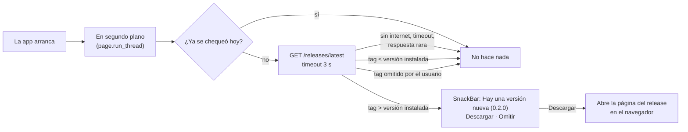

# Spike: Aviso de Versión Nueva desde la App

| Campo           | Valor                                                                                               |
| --------------- | --------------------------------------------------------------------------------------------------- |
| Estado          | Propuesto (no iniciado)                                                                             |
| Fecha           | 2026-11-14                                                                                          |
| Rama sugerida   | `spike/aviso-actualizaciones`                                                                       |
| Timebox         | 1 día. Si se pasa, se corta y se documenta lo aprendido.                                            |
| Relacionado con | US-109 (release por tag, ya hecha), US-404 (AC4: versión embebida en la app), ADR-001 (Local-First) |
| Entregable      | Este documento completado + la decisión de dónde va en el PRD (US nueva o AC de una existente)      |

---

## 1. Contexto

Desde la US-109, cada versión se publica en GitHub Releases con un tag `vX.Y.Z`: instalador `.exe`, `.zip` portable y `.deb`.
Pero quien tiene instalada la v0.1.0 no se entera de que salió la v0.1.1 (un arreglo, o dependencias con una vulnerabilidad
corregida) ni la v0.2.0 (el Hito 2), salvo que entre a GitHub a mirar.

La idea es que la app, al abrirse, **avise** que hay una versión nueva y ofrezca un link para descargarla.

## 2. Pregunta que el spike tiene que responder

> **¿Puede la app, sin bloquear el arranque y sin fallar cuando no hay internet, consultar el último release estable de GitHub,
> compararlo con su propia versión y mostrar un aviso con un link a la descarga?**

Y dos preguntas derivadas:

- ¿Cómo sabe la app empaquetada (`flet build`) **su propia versión**?
- ¿En qué historia de usuario va, para que la **v0.1.0 ya salga con el aviso**? (ver 4.1)

## 3. Cómo funciona

GitHub tiene una API pública que devuelve el último release **estable** (ignora los pre-release `-rc` y los borradores):

```text
GET https://api.github.com/repos/Stack-dos/app_estadisticas/releases/latest

{ "tag_name": "v0.2.0",
  "html_url": "https://github.com/Stack-dos/app_estadisticas/releases/tag/v0.2.0",
  "prerelease": false, ... }
```

> **Comprobado el 2026-11-14:**
>
> - El repositorio se **transfirió** de `nicopinera/app_estadisticas` a la organización `Stack-dos/app_estadisticas`. Con el
>   nombre viejo, la API responde `301 Moved Permanently` hacia `/repositories/1181238798/...` (el id numérico, que no cambia
>   aunque se renombre o se transfiera). `urllib` sigue esa redirección solo, pero conviene usar el nombre actual o el id.
> - Hoy `/releases/latest` responde **404**: solo hay pre-releases (`v0.1.0-rc.N`), y `/latest` los ignora. Es justo lo que se
>   quiere (los `-rc` nunca avisan), y la app tiene que tomar ese 404 como "no hay nada nuevo".



**Ejemplo:** el entrenador tiene la v0.1.0. Publicamos la v0.1.1. Al abrir la app aparece abajo "Hay una versión nueva: 0.1.1 ·
Descargar". Con "Descargar" se abre la página del release; baja el instalador y lo ejecuta. El instalador tiene el mismo `AppId`
(US-109), así que reemplaza la versión vieja, y los datos en `~/.statspro/` no se tocan.

## 4. Puntos a resolver

### 4.1 Tiene que estar en la versión que el usuario ya tiene 🔑

Si la v0.1.0 sale **sin** el chequeo, quien la instale nunca se va a enterar de la v0.2.0: su app no sabe preguntar. Para que sirva
desde el primer usuario, el aviso tiene que entrar **antes de publicar la v0.1.0**, es decir, en el Hito 1.

### 4.2 La app tiene que saber su propia versión

- En desarrollo, `importlib.metadata.version("statspro-basketball")` devuelve `0.1.0`: `uv sync` instala el proyecto con su metadata.
- En la app empaquetada **no hay metadata**: `flet build` copia `src/` tal cual y en la US-109 se excluyó a propósito
  `statspro_basketball.egg-info` (`[tool.flet.app] exclude`). Hay que verificarlo en el spike (paso 5).
- Alternativas:
  - **(a)** Una constante `VERSION = "0.1.0"` en `src/` (por ejemplo, en `config/`), y que el job `version` de `release.yml` la
    compare con el tag, igual que ya compara `pyproject.toml`. Simple; el riesgo (olvidarse de subirla) lo frena el CI.
  - **(b)** Que `release.yml` escriba ese archivo antes del `flet build`. No se puede olvidar, pero en desarrollo la versión sale
    de otro lado.
  - **(c)** Leer `pyproject.toml` en tiempo de ejecución: no sirve, `pyproject.toml` no viaja en el paquete.
- Es el **AC4 de la US-404** ("versión embebida en la app"): se adelantaría.

### 4.3 Comparar versiones como números

`"0.10.0" > "0.9.0"` es **falso** como texto y **verdadero** como versión. Se compara la tupla de enteros: `(0, 10, 0) > (0, 9, 0)`.
Sin dependencias nuevas: para `X.Y.Z` alcanza con `tuple(int(p) for p in "0.10.0".split("."))`. Un tag que no tenga esa forma se
ignora (no se avisa nada).

### 4.4 Offline-first: no molestar nunca

- **Timeout corto** (unos 3 s) y **cualquier error se ignora**: sin internet, con un proxy, con GitHub caído o con un JSON
  inesperado, la app sigue como si nada. Solo queda una línea `info` o `warning` en el log.
- **En segundo plano** (`page.run_thread`): la ventana se dibuja enseguida; el aviso llega cuando llega.
- **Una vez por día como máximo:** la fecha del último chequeo se guarda en `~/.statspro/` (junto a `session.json`).
- **"Omitir esta versión":** se guarda el tag omitido; ese no se vuelve a avisar, el siguiente sí.
- **Nunca los `-rc`:** `/releases/latest` ya los excluye.

### 4.5 Avisar, no autoactualizar

Bajar y ejecutar el instalador solo es posible en Windows: el `.deb` necesita `sudo` y el `.zip` portable no se puede pisar a sí
mismo mientras corre. Además, ejecutar algo bajado de internet sin verificar una **firma** es un riesgo de seguridad, y la firma
es de la US-404. **Se avisa con un link; el usuario descarga e instala.**

### 4.6 Privacidad y límites

- El pedido le muestra la IP del usuario a GitHub (igual que abrir la página). En una app "local" hay que decirlo (RUNBOOK) y
  poder **desactivarlo** (por ejemplo, una casilla en la configuración, o una variable de entorno mientras no haya pantalla de
  configuración).
- La API sin autenticar permite 60 pedidos por hora por IP: con uno por día, sobra.

## 5. Diseño propuesto

Respeta las capas de siempre (sección 5 del PRD): la regla (comparar versiones, decidir si avisar) no sabe de HTTP ni de Flet.

| Capa | Pieza | Qué hace |
| --- | --- | --- |
| Aplicación | `FuenteDeVersiones` (puerto, ABC) | `ultima_version_publicada() -> VersionPublicadaDTO \| None` (tag y URL; `None` si no se pudo saber) |
| Aplicación | `BuscarActualizacionUseCase` | Compara con la versión instalada; aplica "una vez por día" y "versión omitida"; devuelve el DTO o `None` |
| Infraestructura | `GithubReleasesFuente` | `urllib.request` a la API con timeout; cualquier excepción → `None` y log |
| Infraestructura | Almacén del estado | Fecha del último chequeo y tag omitido, en un JSON en `~/.statspro/` (mismo patrón que `JsonSesionAlmacen`) |
| GUI | `app.py` | Después de dibujar la primera pantalla, `page.run_thread(...)` corre el caso de uso; si hay versión, `page.show_dialog(ft.SnackBar(...))` |
| GUI | Botón "Descargar" | Handler `async`: `await ft.UrlLauncher().launch_url(url)` (en Flet 1.1.2 ya no existe `page.launch_url`) |

**API de Flet verificada en 1.1.2:** `Page.run_thread` existe; `ft.SnackBar` y `ft.Banner` son `DialogControl` y se muestran con
`page.show_dialog(...)`; `ft.UrlLauncher().launch_url(url)` es asíncrono.

## 6. Paso a paso

> ⚠️ Igual que en el resto del proyecto: no usar la base ni la sesión reales. Probar con `USERPROFILE`/`HOME` apuntando a una
> carpeta temporal.

1. **Rama** `spike/aviso-actualizaciones` desde la rama de integración del momento.
2. **La API a mano:** `curl -s https://api.github.com/repos/nicopinera/app_estadisticas/releases/latest`. Confirmar que no
   devuelve los `-rc` y qué devuelve si no hay ningún release estable todavía (hoy solo hay pre-releases: debería ser un 404).
3. **Comparación de versiones** en una función pura, con tests: igual, mayor, menor, `0.10.0` contra `0.9.0`, tag con `v`, tag
   raro (`v1.0`, `latest`) → no avisar.
4. **Adaptador con `urllib`** y timeout. Probar: sin internet (desactivar la red), con un timeout forzado (una IP que no responde)
   y con el 404 del paso 2: en los tres casos, `None` y una línea en el log.
5. **Versión en la app empaquetada:** en un build de prueba (el workflow de release con un tag `-rc`, como en la US-109), confirmar
   si `importlib.metadata` falla. Si falla, elegir entre 4.2 (a) y (b).
6. **Aviso en la GUI:** `run_thread` + `SnackBar` + `UrlLauncher`, con una `FuenteDeVersiones` falsa que siempre devuelve
   `v9.9.9`. Verificar que la ventana no se congela y que el botón abre el navegador.
7. **Una vez por día y "Omitir":** abrir y cerrar la app dos veces; el segundo arranque no consulta (verlo en el log).

## 7. Criterios de éxito

- [ ] Sin internet, la app arranca igual de rápido y sin mostrar nada.
- [ ] Con una versión publicada mayor, aparece el aviso y "Descargar" abre la página del release.
- [ ] Con la misma versión o una menor, no aparece nada.
- [ ] Los `-rc` nunca disparan el aviso.
- [ ] La app empaquetada sabe su versión.
- [ ] La lógica (comparar, una vez por día, omitir) tiene tests sin red.

## 8. Riesgos

| Riesgo | Mitigación |
| --- | --- |
| La versión embebida queda desactualizada | El job `version` de `release.yml` la compara con el tag y frena el release |
| El aviso molesta | Una vez por día, "Omitir esta versión" y se puede desactivar |
| Un pedido colgado demora el cierre de la app | Timeout corto; el hilo no bloquea la ventana |
| El repo pasa a privado | La API sin token devuelve 404: la app no avisa, pero no se rompe |
| El repo se renombra o se transfiere (ya pasó: `nicopinera/…` → `Stack-dos/…`) | GitHub redirige (301) y `urllib` lo sigue; más robusto: usar el id numérico del repo (`/repositories/1181238798/releases/latest`), que no cambia |
| Alguien publica por error un release sin binarios | `/latest` lo devolvería; el aviso lleva a una página sin descargas. Se corrige borrando el release |

## 9. Entregables al cerrar el spike

- Este documento con la sección 10 completa.
- La decisión de dónde va en el PRD: **(a)** una US chica nueva en el Hito 1 (por ejemplo, "US-113: Aviso de versión nueva", S,
  1–2 días), que incluya el adelanto de la versión embebida (AC4 de la US-404), para que la **v0.1.0 ya salga con el aviso**; o
  **(b)** dentro de la US-404, en el Hito 4, aceptando que quien instale la v0.1 tenga que enterarse por otro lado.
- La elección de 4.2 (a) o (b).

## 10. Resultados

Pendiente. Al cerrar el spike: qué se probó, qué funcionó, qué no, y la decisión tomada.
